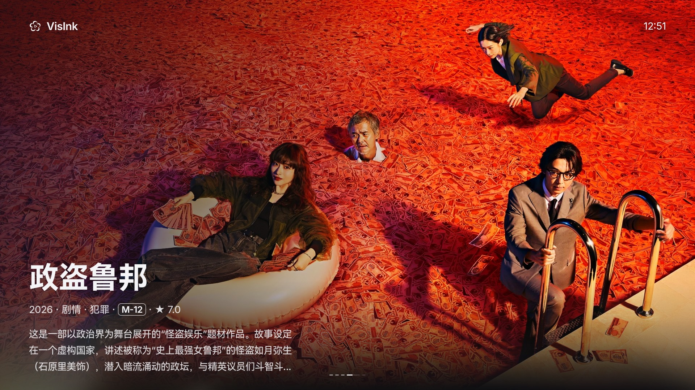
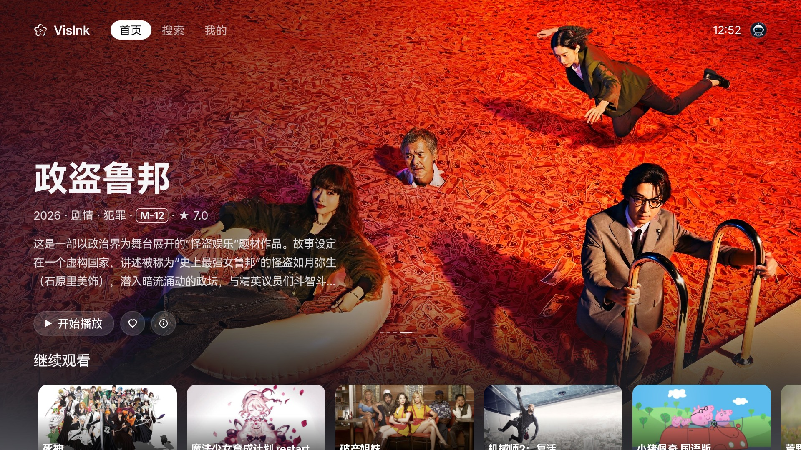
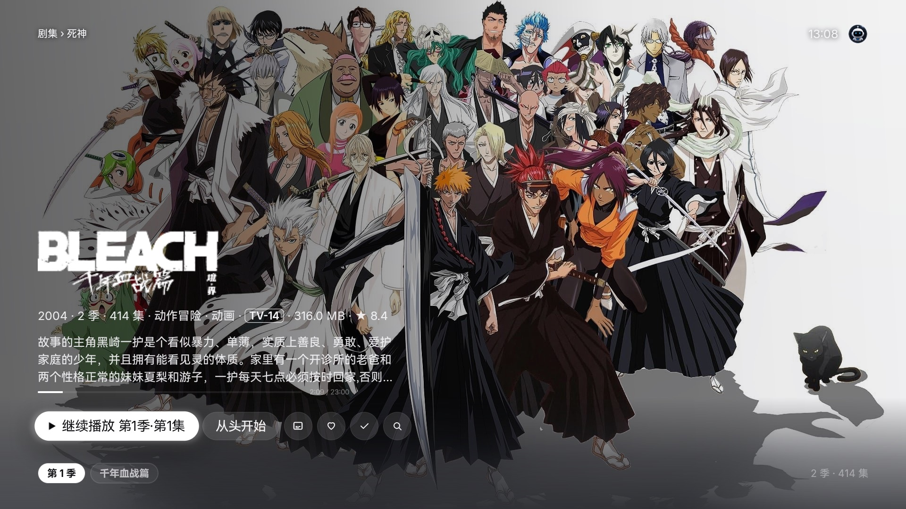
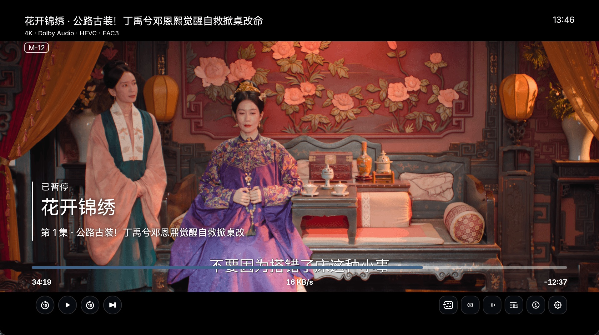
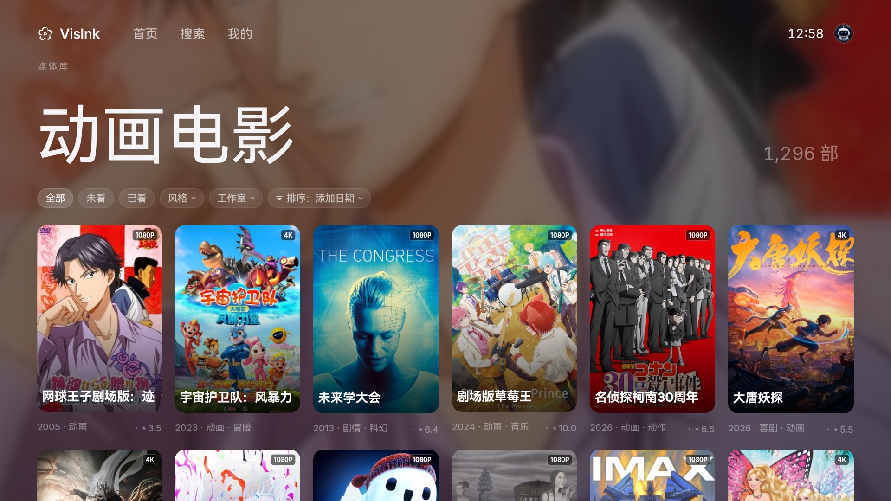
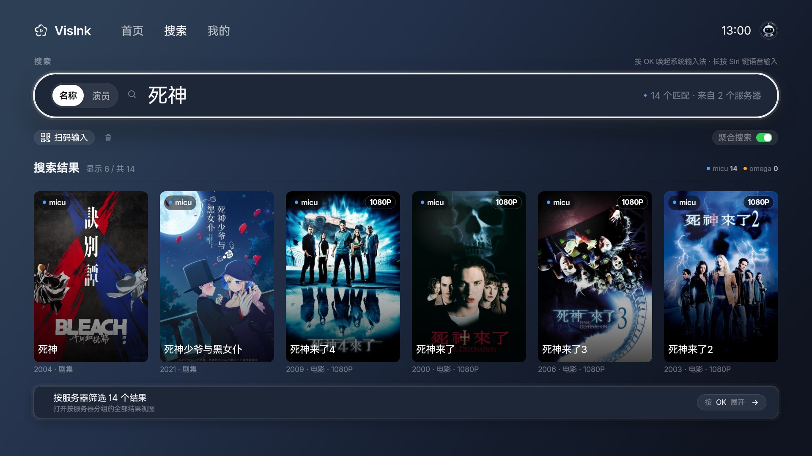
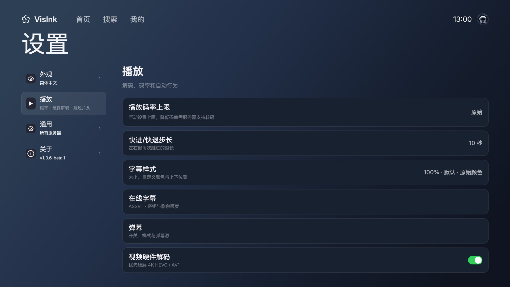

<h1 align="center">
  
  
  VisInk
</h1>

  <strong>English</strong> · <a href="README.md">中文</a>

  A free Emby client for Android TV. 
  Browse your own library with a remote, and play it on the television.

  
  &nbsp;
  
  &nbsp;
  
  &nbsp;
  
  &nbsp;
  

  <a href="https://github.com/skymei/VisInkAndroidTVRelease/releases"><strong>Download</strong></a>

---

  

Immersive carousel after idle

  
  &nbsp;
  

Home · Series details

  
  &nbsp;
  

Playback with danmaku · Paused

  
  &nbsp;
  

Library · Search across servers

  

Playback settings: bitrate, subtitles, danmaku, and decoding

---

## Capabilities

Your media stays on your Emby server. This project is the TV client for signing in, browsing, and playback.

### Library

- Sign in to Emby and keep the session. Multiple servers and accounts.
- A proxy can be set on each server line.
- Home, an idle immersive carousel, continue watching, favorites, and favorite people.
- Library browsing with watched-state filters and sort.
- Search the current server, or every saved server at once. A phone can submit the query by scanning a code.
- Movie and series details, seasons and episodes, and person pages.

### Playback

- Direct play first. The server transcodes only when the TV cannot decode the file.
- A manual bitrate ceiling.
- Hardware video decode. Audio can use automatic, software, or system decode, including AAC, AC3, EAC3, DTS, and TrueHD.
- Audio tracks, playback speed, and several seek step sizes.
- The app can remember speed, audio, subtitles, and version for the same movie or series.
- Intros, credits, and the next episode.
- The active server line can be changed during playback.

### Subtitles and danmaku

- Text subtitles: SRT, VTT, and ASS / SSA, with size, position, and color.
- Image subtitles: PGS, DVB, and VobSub.
- The current subtitle can be nudged earlier or later while playing.
- ASSRT can be connected as an online subtitle source.
- Danmaku follows the film clock, with automatic matching, manual search, style, and a timing offset.
- A compatible danmaku service can be added, including setup from a phone.

### App

- Appearance themes, and three text sizes.
- Interface languages: system, Simplified Chinese, Traditional Chinese, English, Japanese, Korean, Spanish, French, and German.
- Clear video, image, subtitle, danmaku, and update caches by category. Sign-in and settings stay.
- Check GitHub for a stable release and install it over the current app.

## Which APK

APKs are on [Releases](https://github.com/skymei/VisInkAndroidTVRelease/releases). Install the latest stable Release. Pre-Release builds are for testing and are not meant for daily use. To update, install over the existing app. Do not uninstall first — that removes the servers you have already signed in to.

| File | Use |
|---|---|
| `VisInk-*-armeabi-v7a.apk` | 32-bit ARM. **Most TVs should use this.** |
| `VisInk-*-arm64-v8a.apk` | 64-bit ARM |
| `VisInk-*-universal.apk` | All ABIs. Largest file. Use it only when the chip is unknown. |

## Android version and hardware

| | Minimum | Recommended |
|---|---|---|
| System | Android **7.0** (API 24) | Android **12** or later |
| Device | A TV or box with a TV launcher and a D-pad remote. Phones and tablets are not supported. | A 1080p or 4K set you actually use with a remote |
| CPU | 32-bit or 64-bit ARM | Match the device: 32-bit uses v7a, 64-bit uses arm64 |
| Decoding | Hardware H.264 | Hardware H.264 and HEVC. Multichannel audio can fall back to software decode. |
| Network | The TV can reach Emby | Same LAN, or a stable remote link |
| Storage | About 100 MB for an ABI build | Leave room for artwork and the playback cache |

The interface is designed for 1080p. 4K sets work.

## Feedback

Android TV builds vary widely, and physical-device coverage is limited, so a stable release can still hit a compatibility issue. Please install the latest Release.

Open an [issue](https://github.com/skymei/VisInkAndroidTVRelease/issues), or email [support@visink.cc](mailto:support@visink.cc).

Include the Android version, the VisInk version, the TV or box model, the media format, the steps, what you expected, and what happened. A screenshot or screen recording helps.
